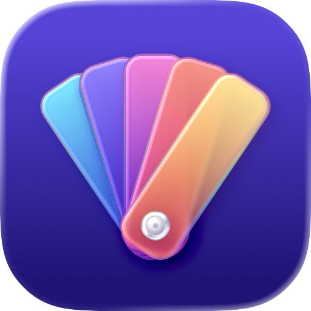
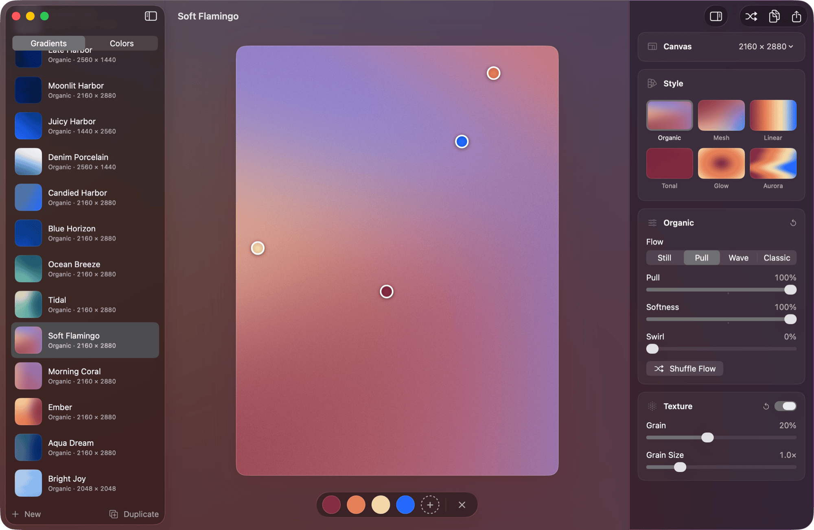

<p align="center">
  
</p>

<h1 align="center">Undertone</h1>

<p align="center">
  Make gradients with film grain on your Mac and export them as PNG or JPEG at any canvas size.
  <br>
  Requires macOS 26 or later.
</p>

<p align="center">
  
</p>

## Features

- **Six styles.** Organic, Mesh, Linear, Tonal, Glow and Aurora. The inspector shows each style as a thumbnail of your current colors.
- **Organic flow modes.** Still, Pull, Wave and Classic, with sliders for Pull, Softness and Swirl.
- **Mesh grid.** A 3 × 3 or 4 × 4 grid of points, each with its own color. Drag points to bend the seams.
- **OKLab blending.** Organic, Mesh and Linear mix colors in OKLab.
- **Film grain.** Grain amount and grain size sliders. Output is dithered to avoid banding.
- **Direct handles.** Drag color points, grid points, the Glow center and the Linear angle on the canvas.
- **Color tray.** Click a color to edit it, drag to reorder, pull it off the tray to remove it.
- **Color collections.** Named collections of colors. Coldwell Banker is added on first launch as an ordinary collection you can edit or delete. Export and import your own.
- **Gradient library.** A saved gradient keeps its colors, points, sliders, seed and canvas size. Editing one opens an unsaved copy that autosaves; ⌘S saves it as a new gradient, ⌥⌘S writes it back over the original. Drag saved gradients to reorder them. Duplicate, rename, delete and undo.
- **Names.** Gradients are named from their colors until you rename them. The dice button in Gradient › Rename… suggests another name from the colors.
- **Canvas sizes.** Presets for Instagram (2160 × 2880), Square (2048 × 2048) and Story (1440 × 2560), plus a custom size.
- **Export.** Save an image with ⌘E, copy it with ⇧⌘C, or drag the canvas into Finder or another app. Files are named like `Harbor Hush 2160x2880.png`.
- **Recipes.** Export a gradient as a `.undertone.json` file and import it on another Mac.
- **GPU rendering.** Metal renders the canvas and exports. At launch Undertone compares GPU output with the CPU renderer and falls back to the CPU if any pixel differs by more than 2/255.

## Install

No prebuilt release is published yet. Build from source with Xcode command-line tools. Undertone builds against DMKit, the package its About window, Help menu, status capsule and inspector controls come from, which must sit next to this folder as `../DMKit`. DMKit isn't published yet.

```sh
git clone https://github.com/dmccullum/Undertone.git
cd Undertone
zsh scripts/build-app.sh
open build/Undertone.app
```

You can also double-click `Build Undertone.command` in Finder. It builds the app, quits a running copy and opens the new build.

The app is ad-hoc signed and not notarized. It runs on the Mac that built it.

## Develop

```sh
swift run -c release   # run from the command line
swift test             # renderer, export, library and naming tests
```

Use the release configuration for `swift run`: the CPU renderer is much slower in debug builds. You can also open `Package.swift` in Xcode. The one package dependency is DMKit, at `../DMKit`.

`UndertoneKit` is the renderer as a library product: it decodes `.undertone.json` recipes and renders them to a `CGImage`, using Foundation, CoreGraphics and Metal only. Other apps add it with `.package(path: "../Undertone")`.

## Keyboard shortcuts

| Shortcut | Action |
| --- | --- |
| ⌘N | New gradient |
| ⌘S | Save as new gradient |
| ⌥⌘S | Update the gradient an unsaved copy came from |
| ⌘R | Randomize |
| ⌘Z | Undo |
| ⌘E | Export image |
| ⇧⌘C | Copy image |
| ⌃⌘S | Hide or show the sidebar |
| ⌥⌘I | Hide or show the inspector |
| ⌘0 | Reopen the window |

## Documentation

- [User guide](docs/USAGE.md): library, canvas, styles and file locations
- [Icon](docs/ICON.md): how the app icon is generated
- [Claude skill](skills/README.md): render Organic backgrounds with grain from Node or a browser
- [Design plan](PLAN.md) and [verification notes](VERIFICATION.md)

## License

[GPL-3.0](LICENSE)
